# Residential Villa: Contemporary residence

*Live, relax, connect, gather, comfort*

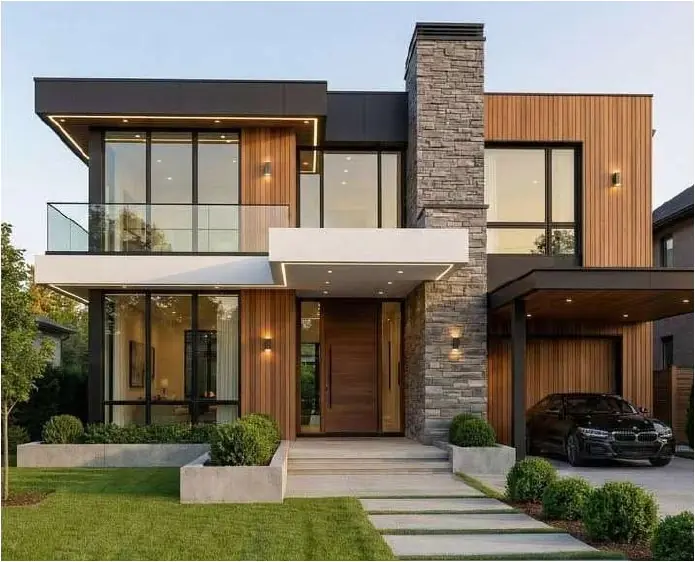

The villa that the interior scheme was developed for

| | |
|---|---|
| **Semester / context** | Semester 4, CAD |
| **Type** | Contemporary residence |
| **Subject** | Computer-aided design |
| **Style** | Contemporary |
| **Focus** | Space planning, furniture layout, material selection, colour palette, lighting, detailing |
| **Key spaces** | Living room, dining, kitchen, bedrooms, bathrooms, terrace and lounge |

## Design brief

The interior design of a given villa in an individually chosen style, covering the planning and detailing of every room with furniture, materials, colours, lighting and space requirements in mind.

## Concept

A contemporary approach built on clean forms, functional planning and a balanced material palette. Modern furniture, subtle colours and layered lighting make rooms that feel comfortable, refined and practical for everyday living.

## Drawings and views

### Design direction: style, materials, furniture and lighting

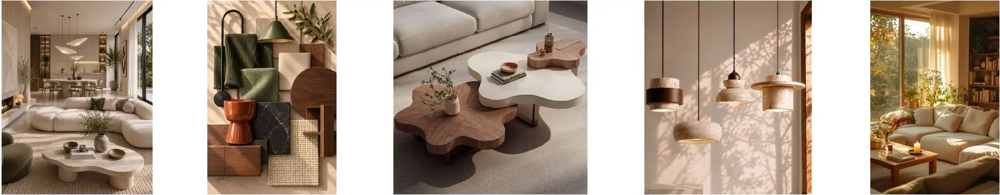

### Ground and first floor plans

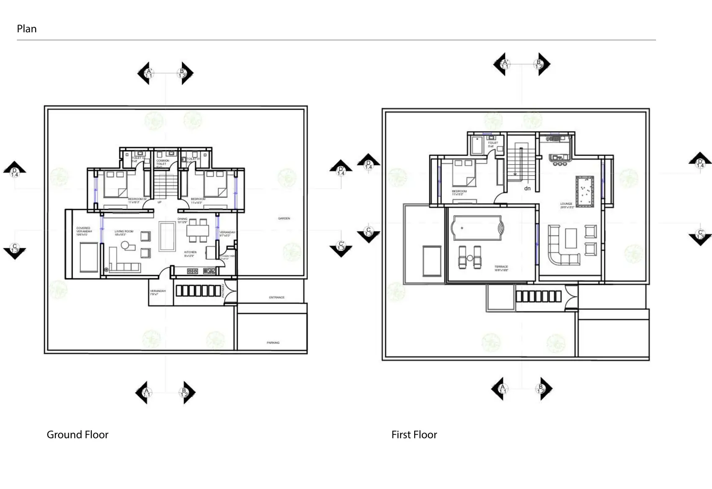

### Rendered ground and first floor plans

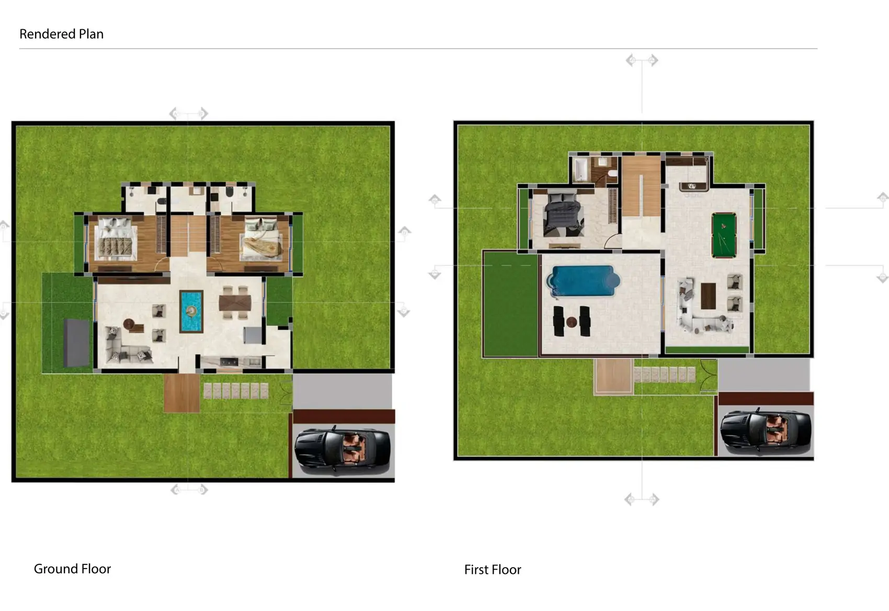

### Sections AA’ and BB’

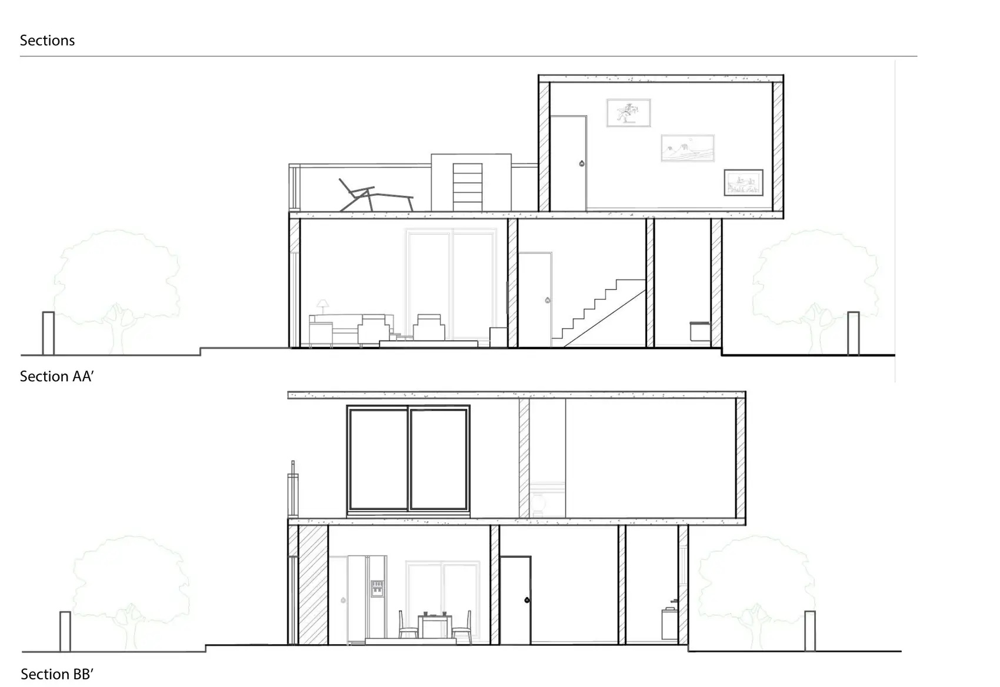

### Sections CC’ and DD’

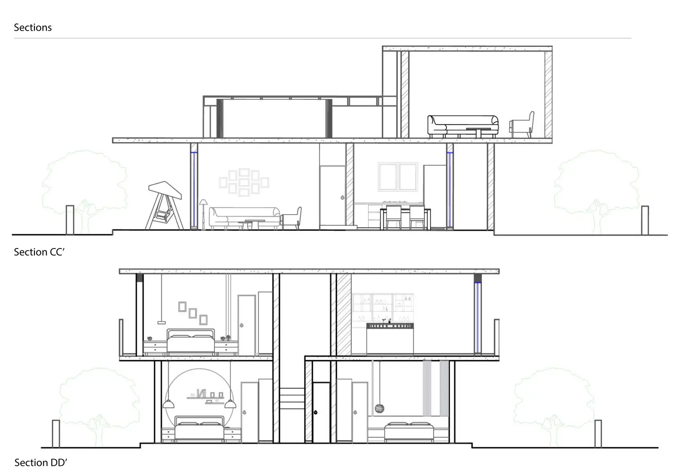

### Rendered sections

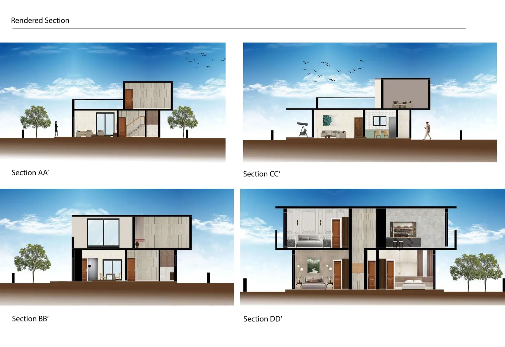

### Bedroom plan and elevations

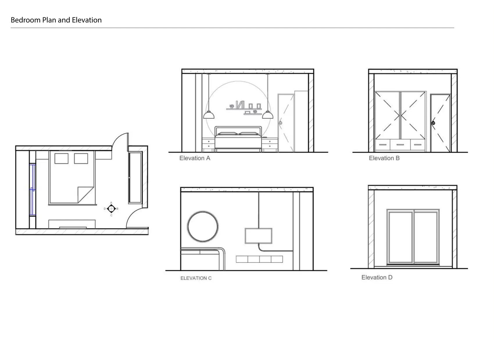

### Bedroom folding plan and wall elevations

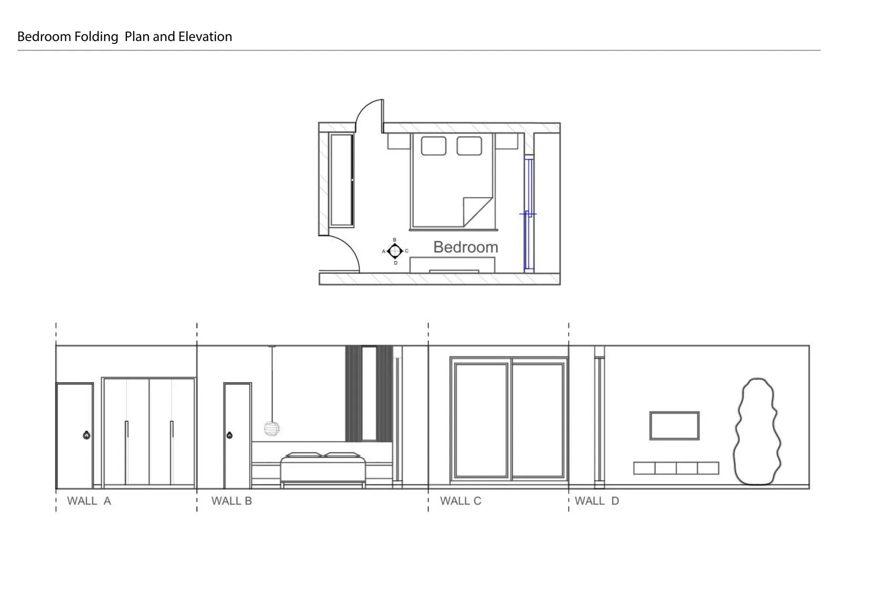

### Bathroom, rendered plan and elevations

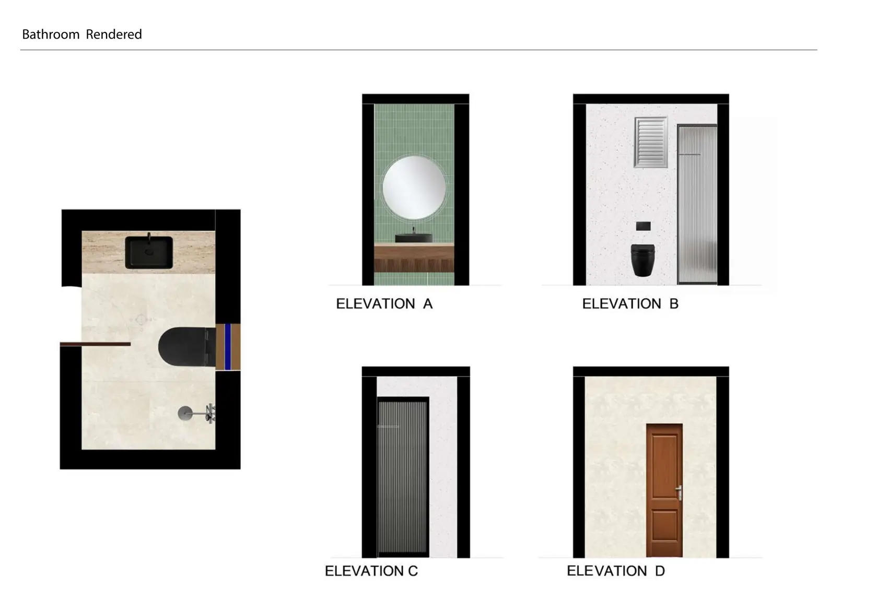

### Kitchen and dining, rendered plan and elevations

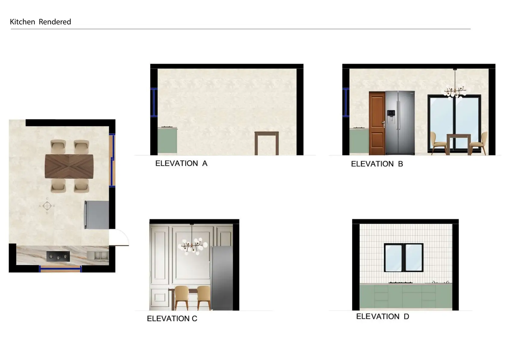

---

Designed by **Pankti Shah**, Bachelor of Design (Interior Design), Indus Design School, Indus University, Ahmedabad.

Full portfolio: [pankti1305.github.io](https://pankti1305.github.io)  
Contact: [pankti1305@gmail.com](mailto:pankti1305@gmail.com)
